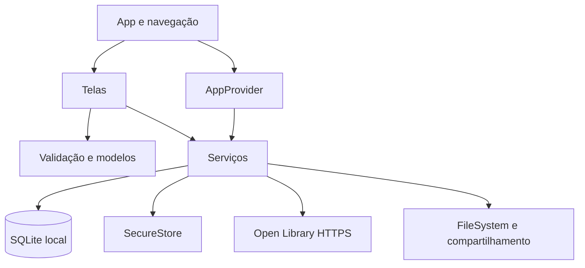

# Arquitetura e documentação do código

## Fluxo

`AppProvider` abre o banco e restaura a sessão antes de montar as rotas. Falha inicial apresenta tentativa novamente. Sem sessão, somente Login/Cadastro existem na pilha. Com sessão, a pilha contém Main, Detalhes e Editor; Main possui Início, Tarefas, Biblioteca e Perfil. A saída desmonta as rotas autenticadas e limpa o estado em memória.

## Responsabilidades por arquivo

| Módulo                       | Responsabilidade e contrato                                                                                     |
| ---------------------------- | --------------------------------------------------------------------------------------------------------------- |
| `domain.ts`                  | Modelos User, Task, TaskInput, Priority e Book; regras puras, normalização, datas, métricas e parsing defensivo |
| `state.tsx`                  | Inicialização, restauração da sessão, login/logout e atualização da lista                                       |
| `ui.tsx`                     | Paleta, estilos, área segura, teclado, campos, botões, chips e feedback reutilizável                            |
| `navigation.ts`              | Tipos de parâmetros; detalhes/editor recebem ID e dados opcionais de leitura                                    |
| `screens/Auth.tsx`           | Credenciais, confirmação de senha, validação e sucesso do cadastro                                              |
| `screens/Home.tsx`           | Métricas e primeiras três tarefas pendentes, ordenadas por prazo                                                |
| `screens/Tasks.tsx`          | Lista virtualizada, filtros, leitura, criação, edição, conclusão e confirmação de exclusão                      |
| `screens/Books.tsx`          | Consulta explícita, status do cache, link externo e criação de tarefa de leitura                                |
| `screens/Profile.tsx`        | Informações de conta, privacidade, exportação e saída                                                           |
| `services/database.ts`       | Conexão única, contas, sessão e cache; delega CRUD ao repositório                                               |
| `services/schema.ts`         | DDL da versão 1, constraints, chaves estrangeiras e índices                                                     |
| `services/taskRepository.ts` | SQL de tarefas e isolamento por proprietário; porta mínima testável                                             |
| `services/password.ts`       | PBKDF2-SHA256 assíncrono e comparação dos hashes                                                                |
| `services/books.ts`          | HTTP com timeout de 8 segundos, cache de 24 horas e fallback offline                                            |
| `services/export.ts`         | Exportação de dados acadêmicos em JSON via FileSystem/Sharing                                                   |

## Modelo persistente

`users`: id UUID, name, email único normalizado, salt e hash. A senha original nunca é persistida. `tasks`: id UUID, owner FK users, title, subject, notes, due (AAAA-MM-DD), priority, done (0/1), created (ISO). O índice `(owner, done, due)` atende à ordenação da lista. `book_cache`: termo normalizado como chave, JSON de livros e data de atualização; retém as últimas 30 consultas.

Os dados sobrevivem ao fechamento do app. `PRAGMA user_version = 1` identifica o esquema inicial. Para uma futura alteração, implementar migrações ordenadas com preservação de dados e testes de upgrade, antes de aumentar essa versão. Não há backend remoto obrigatório: as regras e o armazenamento estão no aparelho.

## Autenticação e proteção

Cadastro exige nome de 2–80 caracteres, e-mail válido e senha de 10–128 caracteres. O salt usa 32 bytes de `expo-crypto`; PBKDF2-SHA256 usa 600.000 iterações e saída de 32 bytes. O feedback de carregamento é exibido antes da derivação assíncrona. A etapa de CPU ainda pode bloquear a interface em aparelhos lentos. A escolha segue a referência [OWASP Password Storage](https://cheatsheetseries.owasp.org/cheatsheets/Password_Storage_Cheat_Sheet.html); desempenho deve ser medido em aparelhos reais.

O ID da sessão é guardado em SecureStore; o usuário é reconsultado ao iniciar. Todas as operações SQL usam parâmetros. Todas as consultas/mutações de tarefas exigem owner. A comparação evita saída antecipada por conteúdo; JavaScript não fornece garantia absoluta de tempo constante. Após cinco falhas de login, há bloqueio de um minuto em memória, que pode ser reiniciado ao fechar o processo.

Esta é autenticação local, sem confirmação de identidade por servidor. Nome/e-mail/tarefas e hashes ficam em SQLite sem criptografia de banco. A proteção do SecureStore não transforma o restante do banco em dados cifrados. Não usar dados sensíveis neste projeto; uma versão de produção exige revisão de ameaças, recuperação de conta, autenticação remota e criptografia apropriada.

## API e offline

Endpoint `GET https://openlibrary.org/search.json`, parâmetros `q`, `lang=pt`, `limit=20`, `fields=key,title,author_name,first_publish_year`. `lang=pt` prioriza resultados em português, sem garantir idioma. O app envia apenas o termo; nenhum dado da conta é enviado. O parsing limita campos e valida URLs de obras para evitar redirecionamentos arbitrários.

Buscas recentes são respondidas pelo cache sem rede por 24 horas. Depois disso, tenta-se atualizar; falhas usam resultados antigos com aviso. Sem cache, apresenta erro e permite repetir. Consultas são explícitas por botão, sem requisições a cada tecla. Novos termos dependem de rede. Links externos também dependem do navegador e da conexão.

## Exportação

`estuda-mais-tarefas.json` é escrito no cache privado do app, sobrescrito em cada exportação e entregue ao seletor nativo de compartilhamento. Inclui versão de formato, timestamp, nome do aluno e tarefas; exclui owner, credenciais e sessão. O arquivo só permanece fora do app se o usuário o salvar/compartilhar. Não há importação.

## Erros e desempenho

Telas impedem ações repetidas enquanto carregam, exibem mensagens locais e permitem repetir. O editor lembra se a gravação já aconteceu para não duplicar uma nova tarefa quando a atualização da lista falha. `ErrorBoundary` captura erro de renderização; erros assíncronos são tratados pelas telas. O banco abre uma única conexão compartilhada e reinicia a tentativa se a inicialização falhar.

Índices, lista virtualizada e cache reduzem custo das operações comuns. As métricas de dashboard são calculadas em memória. A meta de menos de dois segundos ainda exige medição em Android/iOS; busca remota e derivação de senha podem exceder esse tempo. Não há garantia de SLA no projeto acadêmico.
